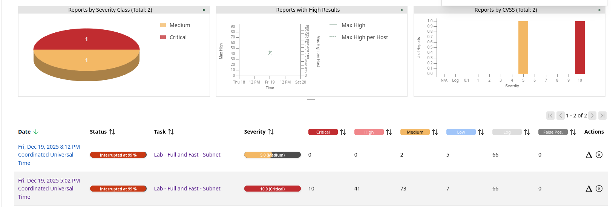

# Vulnerability Management Lab - Nessus & OpenVAS
**Author:** Nikola Marković  
**Last updated:** 2026-10-13  
**Repo:** https://github.com/Oligo12/cyber-projects/  
**Email:** nikola.z.markovic@pm.me  
**LinkedIn:** https://www.linkedin.com/in/nikolazmarkovic/  

[Back to Main README](../README.md)

## Goal
Demonstrate a vulnerability management workflow: scan -> triage -> validate -> remediate -> rescan -> report.

---

## Round 2 (Oct 2026): one finding, end to end

### Lab setup
- Hyper-V, internal virtual switch (192.168.60.0/24), no internet access for the target
- Target: Metasploitable 2 (deliberately vulnerable Ubuntu 8.04 VM), 192.168.60.101
- Nessus Essentials on the Windows host (Basic Network Scan, unauthenticated)
- OpenVAS / Greenbone Community Edition on Kali (Full and fast). Kali had a second network adapter with internet access only for the feed sync; it was disconnected before scanning.

### Approach
Nessus reported 69 findings. Instead of documenting many shallow findings, I took one critical finding through the whole workflow: validation, root cause, prioritization, remediation, verification and a two-scanner comparison.

### Featured finding
- **Critical:** Unauthenticated root bind shell on TCP 1524 (ingreslock backdoor)  
  -> [critical-bind-shell-backdoor](findings/CRITICAL-bind-shell-backdoor.md)

### Key takeaways
- **Highest CVSS is not automatically top priority.** The top score on the scan (Ubuntu 8.04 end of life, 10.0) is planned migration work; the bind shell (9.8) is the immediate risk.
- **No CVE, still critical.** A planted backdoor has no CVE, EPSS or KEV data, so CVE-driven prioritization would miss it. It is an indicator of compromise and belongs with incident response.
- **Verify the fix.** The port was owned by xinetd, not the openbsd-inetd the config file implied, so restarting the wrong service would have left it open. Only the rescan confirmed it was closed.
- **Security tools can silently break scans.** The antivirus on the scanning host blocked Nessus probes, which makes results incomplete without any error. Fixed with a scoped exclusion and a rescan.
- **One scanner is not ground truth.** OpenVAS's active check found the vsftpd 2.3.4 backdoor; the Nessus Basic scan (safe checks) only reported vsftpd as informational.

---

## Round 1 (Dec 2025): first iteration

### Lab setup
- OpenVAS/GVM in Ubuntu VM (Docker)
- Targets:
  - Ubuntu Desktop VM (192.168.56.30)
  - Windows 10 VM (192.168.56.20)
- Scope: internal VirtualBox subnet

### What happened
- First scan produced critical/high package findings on Ubuntu.
- I applied vendor patches (`apt update && apt upgrade`) and rescanned.
- Result: critical/high reduced significantly; remaining findings were mostly configuration/exposure items.
- Note: scans were unstable and reports show "Interrupted at 99%", so I selected a small set of high-confidence findings (high QoD) to document.

### Scope & Limitations
- Scans were executed in an isolated VirtualBox lab subnet (not production).
- Some scans were interrupted at ~99%, so only **high-confidence findings** (high QoD) were selected.
- Findings represent **exposure and configuration risk**, not exploit proof.
- Validation focused on version checks, service exposure, and realistic attack surface.

### Before vs After (evidence)
Screenshot: 

### Findings (selected, validated examples)
- **Critical:** WebKitGTK / JavaScriptCoreGTK (Ubuntu USN-7395-1)  
  -> [critical-webkitgtk](findings/CRITICAL-webkitgtk.md)
- **High:** libssh (Ubuntu USN-7619-1)  
  -> [high-libssh](findings/HIGH-libssh.md)
- **Medium:** Windows RPC / MSRPC enumeration  
  -> [medium-rpc-135](findings/MEDIUM-rpc-135.md)
- **Low:** Weak SSH MAC algorithms  
  -> [low-ssh-weak-mac](findings/LOW-ssh-weak-mac.md)

### Ops Triage Summary (per host)
**Ubuntu (192.168.56.30):** Patch now: WebKitGTK/JavaScriptCoreGTK (USN-7395-1). Patch soon: libssh (USN-7619-1). Hardening: disable weak SSH MACs (policy-dependent).  
**Windows (192.168.56.20):** RPC/135 enumeration was blocked in this lab; enterprise action is to restrict RPC to trusted management hosts/subnets (no broad exposure).
- See: [Reporting templates](templates/)
